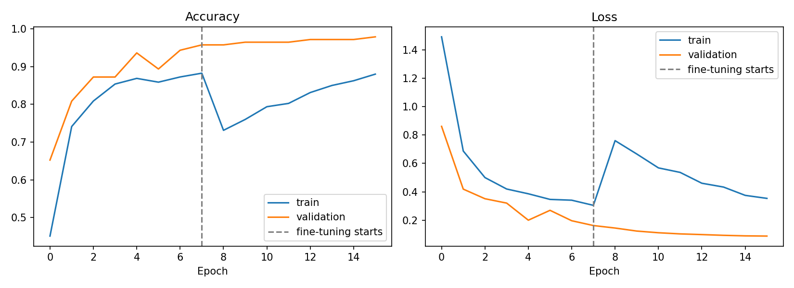
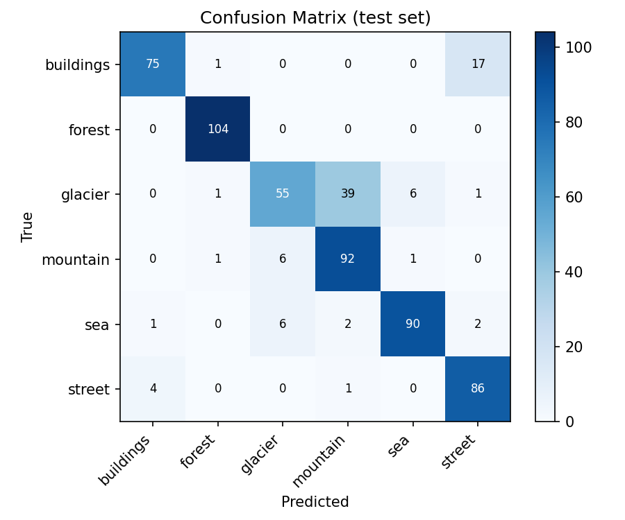

# Image Classification with Deep Learning

A beginner-friendly deep learning project that trains a Convolutional Neural Network (CNN) to recognize objects in images from the **CIFAR-10** dataset (60,000 images, 10 classes: airplane, automobile, bird, cat, deer, dog, frog, horse, ship, truck).

## Key Features

- **Dataset preparation** – loads CIFAR-10 and splits it into train / validation / test sets.
- **Model training and validation** – a CNN with Batch Normalization, Dropout, and built-in data augmentation (flip, rotation, zoom), trained with EarlyStopping, ReduceLROnPlateau and ModelCheckpoint.
- **Performance evaluation** – test accuracy, per-class precision/recall/F1, training curves, and a confusion matrix.
- **Testing predictions on new images** – `predict.py` classifies any image you give it and shows the top guesses with confidence.

## Tech Stack

Python · TensorFlow/Keras · NumPy · Matplotlib · Scikit-learn · Pillow

## Project Structure

```
├── train.py            # data prep, model, training, evaluation
├── predict.py          # classify a new image
├── requirements.txt
└── outputs/            # created after training
    ├── best_model.keras
    ├── final_model.keras
    ├── class_names.json
    ├── classification_report.txt
    ├── training_curves.png
    ├── confusion_matrix.png
    └── sample_predictions.png
```

## How to Run

```bash
pip install -r requirements.txt
python train.py                      # trains and saves results to outputs/
python predict.py my_image.jpg       # test on a new image
```

Optional training arguments: `--epochs 40 --batch-size 128 --output-dir outputs`

## Results

After training, add your numbers and images here:

| Metric | Value |
|---|---|
| Test accuracy | _fill in after training_ |




## Ideas for Improvement

- Transfer learning with MobileNetV2 or ResNet50 (resize images to 96x96 or larger).
- Try PyTorch and compare results.
- Build a small Streamlit/Gradio demo for uploading images.
